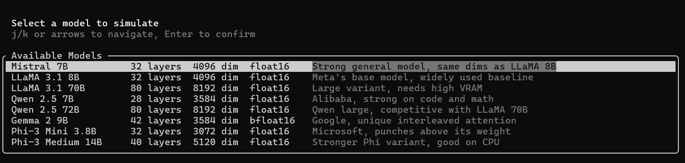
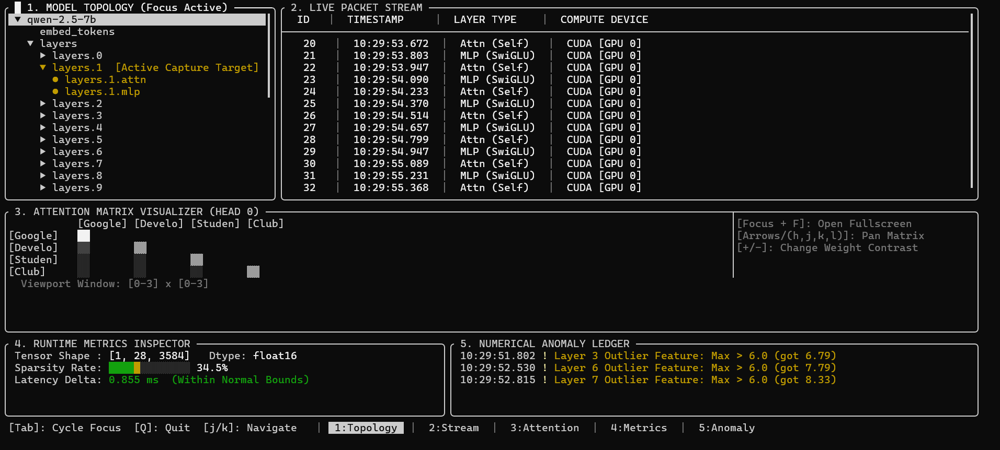

# LLM Instrumentation and Tracing Platform

A real-time telemetry and diagnostic tool for local transformer models. Captures intermediate layer states as tokens flow through the architecture and presents them in an interactive terminal interface.

Built in C++

---

## Features

- Non-invasive hook into the model execution pipeline via `cb_eval` callback
- Real-time capture of tensor shapes, activation statistics, and layer latencies
- Attention matrix heatmap with pan and zoom
- Numerical anomaly detection for outlier activations and VRAM fallbacks
- Fixed-size ring buffer to keep memory usage flat regardless of runtime duration
- Startup model selector with presets for popular architectures
- Vim-style keyboard navigation throughout

---

## Repo Structure

```
llm_tracer/
├── CMakeLists.txt            # build config, fetches FTXUI automatically
├── README.md
└── src/
    ├── main.cpp              # entry point
    ├── model_preset.hpp      # model architecture presets
    ├── model_selector.hpp    # startup model picker screen
    ├── model_selector.cpp
    ├── layer_event.hpp       # core data types
    ├── ring_buffer.hpp       # thread-safe fixed-capacity circular buffer
    ├── model_hook.hpp        # shared event store and anomaly detection
    ├── model_hook.cpp
    ├── demo_runner.hpp       # simulates live inference in a background thread
    ├── demo_runner.cpp
    ├── tui_app.hpp           # five-panel terminal UI
    └── tui_app.cpp
```

---

## Building

Requires CMake 3.20+ and a C++17 compiler. Visual Studio 2022 with the C++ workload is recommended on Windows.

```sh
cmake -B build
cmake --build build --config Release
```

FTXUI is downloaded automatically on the first build. An internet connection is required only for that initial step.

---

## Running

Open **Windows Terminal** and run:

```sh
.\build\Release\llm_tracer.exe
```

A model selector appears first. Use `j/k` to navigate and `Enter` to confirm. The main TUI opens immediately after.

> Block characters in the attention matrix do not render correctly in CMD or legacy PowerShell. Windows Terminal is required.



---

## Interface

The TUI has five panels visible simultaneously.

| Panel | Description |
|---|---|
| 1. Model Topology | Layer tree of the selected model |
| 2. Live Packet Stream | Feed of layer execution events with timestamps and device |
| 3. Attention Matrix | Heatmap of per-head attention weights |
| 4. Runtime Metrics | Tensor shape, dtype, sparsity rate, and latency |
| 5. Anomaly Ledger | Log of outlier activations and CPU fallback events |



---

## Keybindings

**Model selector**

| Key | Action |
|---|---|
| `j / k` | Move through model list |
| `Enter` | Confirm selection |

**Main TUI**

| Key | Action |
|---|---|
| `Tab` | Cycle panel focus |
| `j / k` | Navigate topology tree |
| `Space` | Pin selected layer as active capture target |
| `h j k l` or arrows | Pan attention matrix |
| `+ / -` | Adjust attention weight contrast |
| `F` | Toggle attention matrix fullscreen |
| `Q` | Quit |

---

## Supported Models

All models run in demo mode. No GGUF file is required.

| Model | Layers | Hidden Dim | Dtype |
|---|---|---|---|
| Mistral 7B | 32 | 4096 | float16 |
| LLaMA 3.1 8B | 32 | 4096 | float16 |
| LLaMA 3.1 70B | 80 | 8192 | float16 |
| Qwen 2.5 7B | 28 | 3584 | float16 |
| Qwen 2.5 72B | 80 | 8192 | float16 |
| Gemma 2 9B | 42 | 3584 | bfloat16 |
| Phi-3 Mini 3.8B | 32 | 3072 | float16 |
| Phi-3 Medium 14B | 40 | 5120 | float16 |

To add a custom preset, edit `src/model_preset.hpp` and append to the `PRESETS` list. No other file needs changing.

---

## Configuration

All demo parameters are in `src/demo_runner.cpp`.

| What | Where | Default |
|---|---|---|
| Tokens in attention matrix | `DEMO_TOKENS` | Google, Developer, Student, Club |
| Event generation speed | `sleep_for(milliseconds(...))` | 130ms per event |
| Layers running on CPU | `cpu_threshold = n_layers - 2` | Last 2 layers |
| Anomaly frequency | `bernoulli_distribution(0.07)` | 7% per event |

Anomaly threshold (max activation value) is in `src/model_hook.cpp` and defaults to `6.0`.

Ring buffer capacity is in `src/model_hook.hpp` and defaults to `512` events.

After any change, rebuild with:

```sh
cmake --build build --config Release
```

---

## Dependencies

| Library | Purpose |
|---|---|
| [FTXUI](https://github.com/ArthurSonzogni/FTXUI) | Terminal UI framework, fetched automatically by CMake |
| [llama.cpp](https://github.com/ggerganov/llama.cpp) | Model backend for real GGUF inference (optional) |
